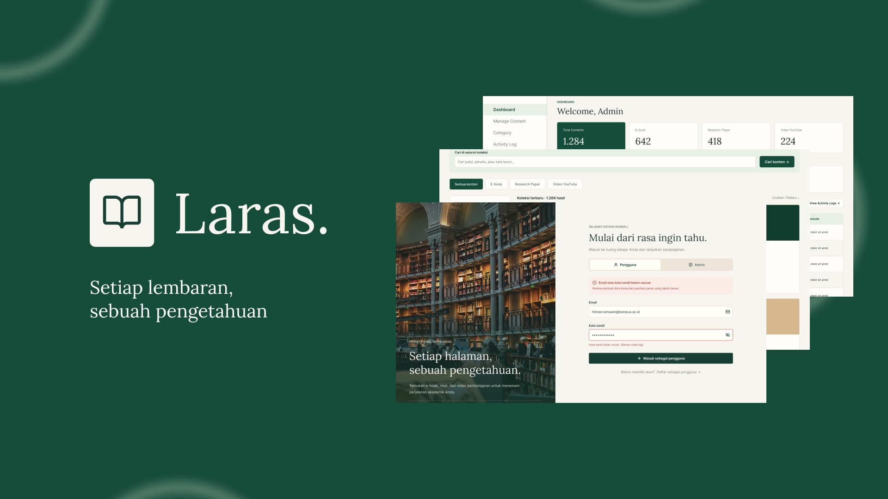

# Laras - Perpustakaan Digital Kampus

Aplikasi perpustakaan digital berisi e-book, research paper, dan video YouTube,
dengan panel admin (kelola konten, kategori, activity log), autentikasi JWT,
audit trail, dan deployment Docker penuh.



## Arsitektur

```
[Browser]
   │  http://localhost:8080
   ▼
[web]  nginx: SPA React (hasil build Vite) + reverse proxy /api
   │
   ▼
[api]  Express 5 (Node 20) - JWT auth, validasi zod, audit log, upload,
   │                          rate limit, helmet, /metrics (Prometheus)
   ▼
[db]   PostgreSQL 16 - users, refresh_tokens, contents, courses, genres,
                        activity_logs (+ fungsi list_contents & list_activity_logs)
```

Keputusan utama dan alasannya (satu baris per keputusan):

- **Express + Node**, satu bahasa dengan frontend React agar satu repo satu skill.
- **PostgreSQL + SQL murni** (tanpa ORM): skema transparan di `db/init/01-schema.sql`,
  teks SQL statis di semua query, nilai lewat bound parameter.
- **Access token 15 menit di memori + refresh token 7 hari di cookie httpOnly**
  (path `/api/auth`): XSS tidak bisa membaca refresh token; rotasi + deteksi
  reuse mencabut semua sesi saat cookie bocor.
- **Berkas disajikan sebagai blob** dari frontend agar membawa `Authorization`;
  endpoint berkas memakai `root` option `res.sendFile` + allowlist nama berkas
  UUID (anti path traversal) dan `Content-Type` tetap + `nosniff` (anti stored XSS).
- **Audit trail di database** (tabel `activity_logs`, append-only) untuk dashboard
  admin; **log operasional** JSON (pino) ke stdout untuk koleksi Docker.
- **Prometheus + Grafana opsional** lewat compose profile, tidak membebani
  startup default.

## Menjalankan

Prasyarat: Docker Desktop (atau Docker Engine + Compose v2).

```bash
cp .env.example .env        # WAJIB: isi semua nilai berawalan GANTI_ di dalamnya
docker compose up --build -d
```

Semua kredensial (sandi database, secret JWT, sandi admin, sandi Grafana)
hanya dibaca dari `.env` - `docker-compose.yml` tidak menyimpan fallback dan
menolak start jika `.env` tidak mengisinya.

### Mode pengembangan

```bash
# Terminal 1: database + api
docker compose up -d db
cd server && npm install && npm run dev

# Terminal 2: frontend (proxy /api ke localhost:3000)
npm install && npm run dev
```

### Monitoring (opsional)

```bash
docker compose --profile monitoring up -d
```

- Prometheus: http://localhost:9090 (target `api:3000/metrics`)
- Grafana: http://localhost:3001 (login sesuai `.env`, datasource Prometheus
  sudah ter-provision otomatis)

## API Ringkas

Semua di bawah `/api`, kecuali auth dan health. Selain `/api/auth/*`,
`/api/health`, dan `/metrics`, semua endpoint memerlukan
`Authorization: Bearer <accessToken>`.

| Method | Rute                        | Akses  | Keterangan                                  |
| ------ | --------------------------- | ------ | ------------------------------------------- |
| POST   | /auth/register              | publik | Daftar akun pengguna                        |
| POST   | /auth/login                 | publik | Login; `asAdmin` menolak akun non-admin     |
| POST   | /auth/refresh               | cookie | Rotasi refresh token + access token baru    |
| POST   | /auth/logout                | cookie | Cabut refresh token, hapus cookie           |
| GET    | /auth/me                    | user   | Profil sesi aktif                           |
| GET    | /categories                 | user   | Daftar mata kuliah + genre                  |
| GET    | /categories/courses . /categories/genres | user | Alias per kategori (kontrak lama `/courses` & `/genres` tetap jalan) |
| POST/PUT/DELETE | /courses[/:id]     | admin  | CRUD mata kuliah                            |
| POST/PUT/DELETE | /genres[/:id]      | admin  | CRUD genre                                  |
| GET    | /contents                   | user   | Katalog: `search`, `type`, `courseId`, `genreId`, `page`, `limit` |
| GET    | /contents/:id               | user   | Detail + mencatat audit VIEW                |
| POST   | /contents                   | admin  | Tambah (multipart: berkas PDF/EPUB atau URL YouTube) |
| PUT    | /contents/:id               | admin  | Edit (berkas opsional)                      |
| PUT    | /contents/:id/status        | admin  | Aktifkan/nonaktifkan (`{ "isActive": true }`) |
| DELETE | /contents/:id               | admin  | Soft delete (`is_active: false`)            |
| GET    | /contents/:id/file          | user   | Streaming PDF/EPUB                          |
| GET    | /admin/stats                | admin  | Jumlah konten per jenis + pengguna          |
| GET    | /admin/activity-logs        | admin  | Log audit: filter `from`, `to`, `action`, `userId` + paginasi |
| GET    | /admin/users                | admin  | Daftar pengguna (untuk filter log)          |
| GET    | /health                     | publik | Healthcheck (ping database)                 |
| GET    | /metrics                    | internal | Metrik Prometheus (tidak terekspos nginx) |

## Keamanan yang Diterapkan

- Password bcrypt (12 round); pembanding hash dummy saat email tak dikenal
  agar waktu respons seragam (anti user-enumeration).
- Kunci akun otomatis: 5 kali gagal → terkunci 15 menit (tersimpan di database).
- Rate limit: global 600/15 menit, login 10 percobaan gagal/15 menit per IP,
  register 30/jam; hanya respons gagal yang dihitung.
- Validasi seluruh input dengan zod; pesan error generik tanpa stack trace.
- Upload: whitelist MIME PDF/EPUB, nama disk acak UUID, batas 25 MB.
- Helmet (security headers), CORS terkonfigurasi, cookie `SameSite=Lax`.
- nginx: `X-Frame-Options`, `nosniff`, `Referrer-Policy`, CSP (embed YouTube dan
  iframe blob: PDF tetap diizinkan), `server_tokens off`, gzip, batas body
  30 MB; `/metrics` tidak di-proxy ke publik. Berjalan unprivileged sebagai
  user `nginx` di port 8080 internal.
- Docker: image `node:22-alpine` (API), user non-root, healthcheck, jaringan
  internal.

## Struktur

```
├── db/init/01-schema.sql      # Skema + fungsi list_contents/list_activity_logs
├── nginx/                     # Konfigurasi reverse proxy + SPA
├── monitoring/                # Prometheus + provisioning Grafana (opsional)
├── server/                    # API Express
│   └── src/
│       ├── middleware/        # auth, audit, rateLimit, upload, validate, errors
│       ├── routes/            # auth, category, content, admin
│       ├── services/          # token (rotasi refresh), storage, content
│       └── seed.js            # Seed awal idempoten
└── src/                       # Frontend React
    ├── api/                   # Axios client + endpoint
    ├── context/AuthContext.jsx
    ├── components/            # ProtectedRoute, ContentCard, ContentState, dll.
    └── pages/                 # Halaman user + admin (semuanya terhubung API)
```

